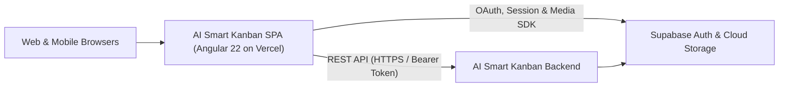

# AI Smart Kanban

[](https://ai-smart-kanban.vercel.app)
[](https://github.com/Sur-bot/AI-Smart-Kanban-Backend)
[](https://angular.dev)
[](https://www.typescriptlang.org)
[](https://tailwindcss.com)
[](https://vitest.dev)
[](https://playwright.dev)
[](#license)

**AI Smart Kanban** is an intelligent, cloud-ready project and task management web application powered by an integrated **AI Copilot**. Built with **Angular 22 Standalone Components**, **Signals**, and **100% Semantic HTML5**, it combines interactive Kanban workflows, workspace collaboration tools, and secure media management into a responsive, mobile-first single-page application (SPA).

- **Live Application:** [https://ai-smart-kanban.vercel.app](https://ai-smart-kanban.vercel.app)
- **Backend Repository:** [https://github.com/Sur-bot/AI-Smart-Kanban-Backend](https://github.com/Sur-bot/AI-Smart-Kanban-Backend)

---

## Ecosystem & Repository Scope

AI Smart Kanban follows a decoupled polyrepo architecture separating client presentation from server-side business logic and infrastructure:

| Layer | Repository | Responsibility |
| :--- | :--- | :--- |
| **Frontend Client** *(Current)* | [Sur-bot/AI-Smart-Kanban](https://github.com/Sur-bot/AI-Smart-Kanban) | Angular 22 SPA, reactive Signal state, Kanban & Table UI, AI Copilot panel, i18n localization, and automated Unit/E2E test suites. |
| **Backend Service** | [Sur-bot/AI-Smart-Kanban-Backend](https://github.com/Sur-bot/AI-Smart-Kanban-Backend) | RESTful API endpoints, AI prompt orchestration, role-based access enforcement, database schemas, background workers, and storage infrastructure. |

> **Note:** Server configuration, database migrations, queue workers, and infrastructure setup are documented and maintained exclusively in the [AI-Smart-Kanban-Backend](https://github.com/Sur-bot/AI-Smart-Kanban-Backend) repository.

---

## Key Features

### Workspace & Kanban Management
- **Dual Task Views:** Seamlessly manage work across interactive drag-and-drop **Kanban Boards** (Angular CDK) and structured **Data Tables** with customizable table preferences and board backgrounds.
- **Batch Operations:** Execute bulk deletions and multi-task attribute updates through a dedicated slide-down batch action bar and modal.
- **Project & Role-Based Collaboration:** Create workspaces, generate shareable project invitation links, and enforce granular member role permissions synchronized with the backend.
- **Rich Task Details:** Jira-inspired task detail modal featuring inline rich-content editing, file attachment menus, status transitions, and contextual metadata.

### Integrated AI Copilot
- **Contextual Assistant:** Built-in right-sidebar AI Copilot designed to assist with task breakdown, workspace queries, and smart workflow actions.
- **Resilient Client UX:** Features sanitized Markdown rendering, client-side request locking to prevent duplicate submissions, and graceful permission/error toast feedback.

### Collaboration Suite & Right-Bar Ecosystem
- **Unified Productivity Dock:** Quick-access right navigation bar housing **AI Copilot**, **Direct Chat**, **Task Chat**, **Channels**, **Notifications**, and **Workspace Settings**.

### Cloud Image Storage Center
- **Optimized Media Handling:** Dedicated image storage module supporting batch uploads, progressive image loading via Low-Quality Image Placeholders (LQIP), adjacent image navigation, and multi-select bulk deletion.
- **Quota Tracking:** Real-time visual storage quota progress indicators per user account.

### Authentication, Localization & Mobile-First UX
- **Multi-Provider Authentication:** Email registration with verification flows plus Google and Facebook OAuth integration powered by Supabase Auth.
- **Bilingual Support (i18n):** Dynamic English (`en`) and Vietnamese (`vi`) translation switching via `@ngx-translate`.
- **Semantic & Responsive Design:** Engineered with strict Semantic HTML5, accessible ARIA labels, Angular Material iconography (`<mat-icon>`), and mobile-first layouts including adaptive mobile bottom sheets.

---

## Client Architecture



---

## Tech Stack

| Category | Technology |
| :--- | :--- |
| **Core Framework** | Angular 22 (Standalone Components, Signals, Lazy-Loaded Routes) |
| **Language** | TypeScript 6.0, RxJS 7.8 |
| **Styling & UI** | Tailwind CSS 3.4, SCSS, Angular Material & Angular CDK 22 |
| **Icons & Typography** | Material Icons (`<mat-icon>`), Plus Jakarta Sans & Montserrat |
| **Auth & Cloud Client** | `@supabase/supabase-js` 2.x |
| **Internationalization** | `@ngx-translate/core` & `@ngx-translate/http-loader` 18 |
| **Unit Testing** | Vitest 4, JSDOM, `@vitest/coverage-v8` |
| **End-to-End Testing** | Playwright Test 1.62 (Page Object Model, Chromium & Firefox) |
| **Deployment** | Vercel (SPA Rewrite Configuration) |

---

## Project Structure

```text
ai-smart-kanban/
├── e2e/                          # Playwright End-to-End test suite
│   ├── pages/                    # Page Object Models (kanban, login, register, storage)
│   └── tests/                    # Auth setup & feature test specifications
├── public/
│   └── assets/
│       ├── config/               # Dynamic feature tab configurations
│       ├── i18n/                 # Translation dictionaries (en.json, vi.json)
│       └── images/               # Backgrounds, illustrations & tech icons
├── src/
│   └── app/
│       ├── core/                 # Auth guards, HTTP interceptors, global state & services
│       ├── features/             # Domain modules:
│       │   ├── auth/             # Login, Register, OAuth Callback & Email Verification
│       │   ├── image-storage/    # Cloud media grid, upload zone, detail modal & quota UI
│       │   ├── kanban/           # Projects, Kanban board, Data table, Batch & Task modals
│       │   ├── landing-page/     # Public product showcase & navigation
│       │   └── right-bar-features/# AI Copilot, Chat, Channels, Notifications & Settings
│       ├── layout/               # Main shell: Header, Sidebar, Right-bar & Footer
│       └── shared/               # Reusable UI components (e.g., 404 Not Found) & models
├── angular.json                  # Angular CLI build, serve & test architect configuration
├── playwright.config.ts          # Playwright multi-browser & local dev server config
├── tailwind.config.js            # Design system tokens & responsive breakpoints
└── vercel.json                   # Vercel SPA routing rules
```

---

## Getting Started

### Prerequisites

- **Node.js** (Latest LTS recommended) and **npm** `11.x`
- Active connection to the [AI-Smart-Kanban-Backend](https://github.com/Sur-bot/AI-Smart-Kanban-Backend) service

### Installation & Local Development

1. **Clone the frontend repository:**
   ```bash
   git clone https://github.com/Sur-bot/AI-Smart-Kanban.git
   cd AI-Smart-Kanban
   ```

2. **Install dependencies:**
   ```bash
   npm install
   ```

3. **Start the development server:**
   ```bash
   npm start
   ```
   Open `http://localhost:4200/` in your browser. The app will hot-reload automatically as you edit source files.

---

## Scripts & Quality Assurance

| Command | Description |
| :--- | :--- |
| `npm start` | Launch the local Angular development server at `http://localhost:4200` |
| `npm run build` | Build optimized production artifacts into the `dist/` directory |
| `npm run watch` | Build continuously in `development` mode on file changes |
| `npm test` | Execute unit tests via **Vitest** |
| `npm run test:e2e` | Run headless End-to-End tests with **Playwright** |
| `npm run test:e2e:ui` | Open interactive Playwright UI mode for test debugging |
| `npm run test:e2e:ci` | Run Playwright tests formatted with the GitHub Actions reporter |
| `npm run test:e2e:report` | View the latest HTML report generated by Playwright |

---

## Frontend Engineering Standards

Contributions to this repository adhere to strict architectural conventions:

- **100% Semantic HTML5:** Use meaningful structural elements (`<header>`, `<nav>`, `<main>`, `<aside>`, `<section>`, `<article>`, `<footer>`, `<fieldset>`) and ordered headings (`h1` → `h2` → `h3`) for accessibility, SEO, and AI search discoverability.
- **Mobile-First Responsive UI:** Author styles starting from mobile viewports and scale upward using consistent Tailwind breakpoints (`sm`, `md`, `lg`, `xl`, `2xl`). Components encapsulate their own responsive behavior and preserve `title` / `aria-label` attributes when text labels collapse on smaller screens.
- **Material Iconography:** Use Angular Material `<mat-icon>` consistently rather than ad-hoc inline SVGs.
- **Conventional Commits:** Structure commit messages using `<type>(<scope>): <short description>` (`feat`, `fix`, `style`, `refactor`, `docs`, `test`, `chore`).

---

## Author

- **Anh Nguyen** — [@Sur-bot](https://github.com/Sur-bot)

---

## License

Distributed under the **MIT License**. Copyright © 2026 **Anh Nguyen**.
